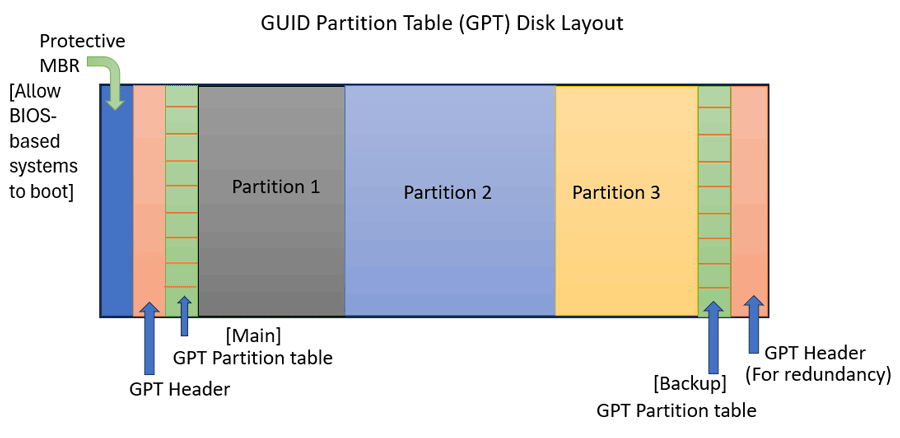
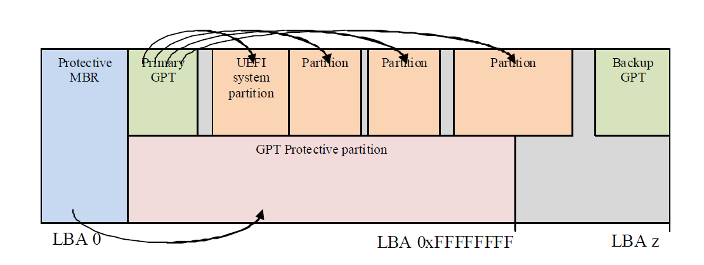

# Disk Blueprint

* Each LBA Sector has 512 Byte data
* Each Partition Entries Has 128 Byte data so each LBA Sector can hold 4 Partition Entries

* The Number of Partition Entry is equal to the total Partitions present in the Disk.

* A GPT Disk can hold maximum 128 Partition so there only has 128 Partition Entries space.

Suppose a Disk has total n Sectors so Total disk space would be n * 512 bytes i.e. n*512/(1024*1024) MB.

## Blueprint of a 2MB Disk

Now I am giving a Blueprint of a Disk Which has three Partitions

Disk Space = 2 MB/ 2048 KB/ 2097152 Byte
Total LBA Sector = 4096

| LBA Sector | Content                         |
|------------|---------------------------------|
| 0          | Protective MBR + BIOS Boot Code |
| 1          | Primary GPT Header              |
| 2          | PE-1  | PE-2   |  PE-3  | Blank |
| 3          | Blank | Blank  |  Blank | Blank |
| 4          | Blank | Blank  |  Blank | Blank |
| 5          | Blank | Blank  |  Blank | Blank |
| 6          | Blank | Blank  |  Blank | Blank |
| 7          | Blank | Blank  |  Blank | Blank |
| 8          | Blank | Blank  |  Blank | Blank |
| 9          | Blank | Blank  |  Blank | Blank |
| 10         | Blank | Blank  |  Blank | Blank |
| 11         | Blank | Blank  |  Blank | Blank |
| 12         | Blank | Blank  |  Blank | Blank |
| 13         | Blank | Blank  |  Blank | Blank |
| 14         | Blank | Blank  |  Blank | Blank |
| 15         | Blank | Blank  |  Blank | Blank |
| 16         | Blank | Blank  |  Blank | Blank |
| 17         | Blank | Blank  |  Blank | Blank |
| 18         | Blank | Blank  |  Blank | Blank |
| 19         | Blank | Blank  |  Blank | Blank |
| 20         | Blank | Blank  |  Blank | Blank |
| 21         | Blank | Blank  |  Blank | Blank |
| 22         | Blank | Blank  |  Blank | Blank |
| 23         | Blank | Blank  |  Blank | Blank |
| 24         | Blank | Blank  |  Blank | Blank |
| 25         | Blank | Blank  |  Blank | Blank |
| 26         | Blank | Blank  |  Blank | Blank |
| 27         | Blank | Blank  |  Blank | Blank |
| 28         | Blank | Blank  |  Blank | Blank |
| 29         | Blank | Blank  |  Blank | Blank |
| 30         | Blank | Blank  |  Blank | Blank |
| 31         | Blank | Blank  |  Blank | Blank |
| 32         | Blank | Blank  |  Blank | Blank |
| 33         | Blank | Blank  |  Blank | Blank |
| 34         | Blank                           |
| ...        | .....                           |
| 2047       | Blank                           |
| 2048       | EFI                             |
| ....       | ....                            |
| ....       | FAT32                           |
| ....       | ....                            |
| ....       | FAT32                           |
| ....       | ....                            |
| 4063       | BPE-1 | BPE-2  | BPE-3  | Blank |       
| 4066       | Blank | Blank  |  Blank | Blank |
| 4065       | Blank | Blank  |  Blank | Blank |
| 4066       | Blank | Blank  |  Blank | Blank |
| 4067       | Blank | Blank  |  Blank | Blank |
| 4068       | Blank | Blank  |  Blank | Blank |
| 4069       | Blank | Blank  |  Blank | Blank |
| 4070       | Blank | Blank  |  Blank | Blank |
| 4071       | Blank | Blank  |  Blank | Blank |
| 4072       | Blank | Blank  |  Blank | Blank |
| 4073       | Blank | Blank  |  Blank | Blank |
| 4074       | Blank | Blank  |  Blank | Blank |
| 4075       | Blank | Blank  |  Blank | Blank |
| 4076       | Blank | Blank  |  Blank | Blank |
| 4077       | Blank | Blank  |  Blank | Blank |
| 4078       | Blank | Blank  |  Blank | Blank |
| 4079       | Blank | Blank  |  Blank | Blank |
| 4080       | Blank | Blank  |  Blank | Blank |
| 4081       | Blank | Blank  |  Blank | Blank |
| 4082       | Blank | Blank  |  Blank | Blank |
| 4083       | Blank | Blank  |  Blank | Blank |
| 4084       | Blank | Blank  |  Blank | Blank |
| 4085       | Blank | Blank  |  Blank | Blank |
| 4086       | Blank | Blank  |  Blank | Blank |
| 4087       | Blank | Blank  |  Blank | Blank |
| 4088       | Blank | Blank  |  Blank | Blank |
| 4089       | Blank | Blank  |  Blank | Blank |
| 4090       | Blank | Blank  |  Blank | Blank |
| 4091       | Blank | Blank  |  Blank | Blank |
| 4092       | Blank | Blank  |  Blank | Blank |
| 4093       | Blank | Blank  |  Blank | Blank |
| 4094       | Blank | Blank  |  Blank | Blank |
| 4095       | Backup GPT Header               | 

