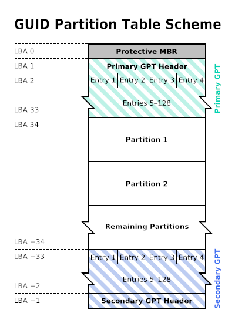

[](https://github.com/baponkar/keblaOS-Note)


# GPT DISK

GPT stands GUID PARTITION TABLE. GPT Disk is essential to make UEFI Bootable Disk.A GPT Disk can able to hold maximum 128 logical partitions.This GPT is required for UEFI Boot.So to make UEFI bootable disk first need GPT and also required FAT32 Filesystem. The filesystem hold bootloader and kernel. The most modern OS is using UEFI Boot instead legacy BIOS bootable disk.In this article I am discussing how could we make a GPT disk as well as test that disk.
Suppose We are making ESP(EFI Partition) starts at SECTOR 2048 and it's size is 100 MB. The Second Data Partition is just starts after end of ESP and stay remain rest of space.
Here I am considering total Disk Space is 1 GB.

Here The structure of whole Disk under GPT



Now the calculation is here

SECTOR_SIZE = 512 Bytes

TOTAL_SECTORS = 1 * 1024 * 1024 * 1024 / 512 = 2097152

MAX_PARTITION_ENTRY = 128

PARTITION_ENTRY_SIZE = 128

Each Partition entry size is 128 Bytes i.e. each sector is containing 512/128 = 4 partition entries. For total sectors is required for all 128 partitiion entries is 128 * 128 / 512 = 32 

TOTAL_PARTITION_ENTRY_RESERVED_SECTORS = 32

The Protective MBR reserved sector 0, GPT Header reserved Sector 1, next 32(Sector 2 to Sector 33) sectors reserved for 128 partition entries, 

The First Partition here ESP starts from 2048 which is 1MB aligned .So the Sectors are zero from sector 34 to 2047.

Protective MBR do not need Backup MBR.
GPT also store Backup GPT Header at last sector and GPT entry tables at last 32 sectors i.e. from sector  to last_sector_no - 32 to last_sector_no - 1.

## GPT Partition Entry Table
The GPT Partition Entry structure is 
```c
typedef struct __attribute__((packed)) {
    uint8_t type_guid[16];
    uint8_t unique_guid[16];
    uint64_t start_lba;
    uint64_t end_lba;
    uint64_t attributes;
    char name[72];      // UTF-16LE encoded, but we'll use ASCII for simplicity
} GPTPartitionEntry;    // 128 bytes
```
The above GPT Partition entry exactly show it's size is 128 Bytes.Here I am giving some pre defined GUIDs

* ESP Type GUID : C12A7328-F81F-11D2-BA4B-00A0C93EC93B
* LINUX Type GUID : 0FC63DAF-8483-4772-8E79-3D69D8477DE4 


## Protective MBR
The protective MBR is behaving a single fake Partition of whole disk space.
```c
typedef struct __attribute__((packed)) {
    uint8_t boot_code[440];
    uint32_t disk_signature;
    uint16_t reserved;
    struct __attribute__((packed)) {
        uint8_t status;
        uint8_t chs_start[3];
        uint8_t type;
        uint8_t chs_end[3];
        uint32_t lba_start;
        uint32_t sector_count;
    } partition[4]; // 64 byte
    uint16_t signature;
} ProtectiveMBR;    // 512 bytes
```
The MBR is also containng 440 bytes boot code for BIOS boot.You can see MBR is exactly 512 bytes.

## GPT Header
The Sector 1 and last sector is containg GPT Header which is only 92 bytes so it is taking only 92 bytes in a single sector and rest of sector is zero.

```c
typedef struct __attribute__((packed)) {
    char signature[8];        // "EFI PART"
    uint32_t revision;
    uint32_t header_size;
    uint32_t header_crc32;
    uint32_t reserved;
    uint64_t current_lba;
    uint64_t backup_lba;
    uint64_t first_usable_lba;
    uint64_t last_usable_lba;
    uint8_t disk_guid[16];
    uint64_t entries_lba;
    uint32_t entries_count;
    uint32_t entry_size;
    uint32_t entries_crc32;
} GPTHeader;    // 92 bytes
```

## Test GPT by Unix/Linux  Tools
There are multiple Unix/Linux tools to test and create GPT Disk now I am giving some tools usage suppose disk image(disk_1.img) is present at directory disk_img/ then

```bash
fdisk -l disk_img/disk_1.img
gdisk -l disk_img/disk_1.img
parted disk_img/disk_1.img print
qemu-img info disk_img/disk_1.img
```

To look inside of the disk first 32 lines of all sector data
```
# Read first 32 lines of whole disk
hexdump -C disk_img/disk_1.img | head -32

#inspect LBA0(Starts from 0) i.e. MBR
hexdump -C -n 512 disk_img/disk_1.img

#inspect LBA1(Starts from 512) i.e. GPT Header
hexdump -C -s 512 -n 92 disk_img/disk_1.img

#inspect LBA2(Starts from 1024) i.e. GPT Partition Table i.e. First 4 partition entries
hexdump -C -s 1024 -n 512 disk_img/disk_1.img
```

To look the image the result gives MBR based result
```
file disk_img/disk_1.img
```

To check disk image by using linux loopdevice

Too see all loop device
```
losetup -a
```
filter attached loopdevice with given name
```
losetup -a | grep disk_1.img
```

Attach a loopdevice

```
sudo losetup -fP --show disk_img/disk_1.img
```

Checking loopdevice content if above output is gives loop0 then
```
sudo fsck.fat -v -n /dev/loop0p1
```

Mount the loopdevice into a mnt1 directory
```
mkdir -p disk_img/mnt1
sudo mount /dev/loop0p1 disk_img/mnt1
```

Now list directory and files
```
ls -R disk_img/mnt1
```

Unmount and remove loopdevice so that it can be use by WinImage or OSFMount which are GUI based disk inspection tool in Windows.

```
sudo umount /dev/loop0 2>/dev/null
sudo umount -R disk_img/mnt1 or sudo umount disk_img/disk_1.img 2>/dev/null
sudo losetup -d /dev/loop0
```

## Creating GPT by Unix/Linux Tool

```
# Creating GPT
sgdisk -o disk_img/disk_1.img

# Creating ESP
sgdisk -n 1:2048:206847 -t 1:ef00 disk_img/disk_1.img

# Creating Data partition
sgdisk -n 2:206848:0 -t 2:8300 disk_img/disk_1.img
```

# Reference

* [wiki.osdev.org](https://wiki.osdev.org/GPT)

